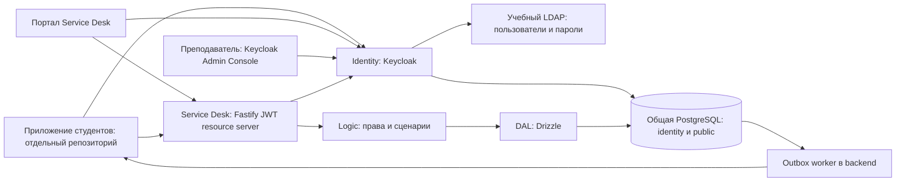

# Архитектура учебного контура

## Назначение и границы

В репозитории два самостоятельных внешних сервиса для студенческого приложения:

- **Identity:** Keycloak, общая PostgreSQL (схема `identity`) и учебный LDAP. Пользователями, паролями и ролями управляет преподаватель через Keycloak Admin Console.
- **Service Desk:** Jira-совместимый API, встроенный Angular UI создания и просмотра обращений и настройки уведомлений, PostgreSQL, миграции и outbox worker. API проверяет JWT Identity как resource server.

Приложение модерации студентов находится **в отдельном репозитории**. Наш прежний портал — тестовая часть Service Desk и встроен в `apps/service-desk/ui`; API — `apps/service-desk/src`. UI начинает OIDC-вход SDK через публичный клиент `service-desk-test`; пароль собирается только в Identity. API не создаёт cookie-сессию и не обменивает authorization code.

Корпоративные доступы не нужны. Контур не служит установкой Jira или копией корпоративного ADFS.

## Карта компонентов

Один PostgreSQL и одна БД `training`: таблицы Service Desk — в `public`, таблицы Keycloak — в `identity`. Отдельная SQL-роль Identity имеет доступ к своей схеме. Compose содержит пять сервисов: `postgres`, `ldap`, `identity`, одноразовый `migrate` и `service-desk`. Bootstrap — инструмент, а не постоянно работающий сервис. Локальные порты по умолчанию: Identity — `8081`, Service Desk — `8080`.

## Документы

| Область                                         | Документ                                            | Пути                                    |
| ----------------------------------------------- | --------------------------------------------------- | --------------------------------------- |
| Identity, пользователи, роли, handoff студентам | [Identity](../identity.md)                          | `apps/identity`, `infra/ldap`           |
| Сервер и данные                                 | [сервер.md](backend.md)                             | `apps/service-desk/src/{api,logic,dal}` |
| Настройки JSON                                  | [settings](../settings.md)                          | `config/backend.json`, `libs/settings`  |
| JWT, tenant-доступ и события                    | [security-and-events.md](security-and-events.md)    | `libs/auth`, `libs/webhooks`            |
| Тема входа Identity                             | [identity-theme.md](identity-theme.md)              | `apps/identity/theme`, `libs/theme`     |
| Контракт Jira                                   | [совместимость API](../api-compatibility.md)        | `docs/vendor`, API, DTO                 |
| Docker и установка                              | [Docker](../docker.md), [Setup](../agents/setup.md) | Compose, Dockerfiles, bootstrap         |
| Проверки                                        | [Verification](../agents/verification.md)           | package scripts, тесты                  |

## Сквозной сценарий

1. Портал Service Desk использует публичный клиент `service-desk-test`, а внешнее приложение студентов — `student-service`. Оба входят через Identity по Authorization Code + PKCE S256.
2. Keycloak проверяет пароль через общий LDAP и выдаёт access token с audience `service-desk`, `team_slug` и роли клиента `service-desk`.
3. Студенческое приложение вызывает Service Desk API с `Authorization: Bearer <access_token>`.
4. API проверяет подпись через JWKS, issuer, audience, срок действия, роль и активную команду. Допуск определяется **ролями Keycloak**, а не LDAP-группами.
5. Создание обращения `10001` сохраняет задачу, историю и `jira:issue_created` в одной транзакции.
6. Worker создаёт доставку только для заранее зарегистрированной подписки команды и отправляет подписанный webhook приложению студентов. Ответ `201` без настроенного получателя не означает доставку уведомления.

Учебный тип `10001` моделирует замену оборудования. Это новая конфигурация стенда; она не заявляется как подтверждённая корпоративная форма. Исследованные типы `183` и `194` сохраняются отдельно.

## Источники состояния

- Пользователи, пароли и атрибут команды — общий LDAP стенда с доступом на запись через Keycloak.
- Клиенты, роли клиента и назначения ролей — схема `identity` общей PostgreSQL.
- Обращения, активность API-команд, совместимые статические API-токены, outbox и доставки — PostgreSQL Service Desk.
- JWT проверяется на каждом API-запросе; Identity не выдаёт прямой доступ к SQL или административным операциям без соответствующей роли.
- Оформление темы Identity и портала Service Desk — общая SCSS-библиотека `libs/theme`; студенческое приложение сюда не входит.
- JSON `SETTINGS_FILE` — основной источник настроек. Обработчик переносит адреса уведомлений из JSON в SQL без перезапуска; остальные параметры применяются после перезапуска.

## Ограничения

Приложение студентов находится в отдельном репозитории. Не реализованы собственный интерфейс преподавателя, массовая генерация и сброс, вложения, участники запросов, SLA, 1С, внешние резервные копии и настройка внешнего HTTPS. Keycloak Admin Console управляет Identity; API-команды Service Desk создаются отдельно и не возникают автоматически при добавлении пользователя.

Сервис студентов получает новые обращения через webhook и читает их по ключу. Повторы доставки возможны; общий порядок не гарантируется. Локальный HTTP предназначен для разработки; публикация требует отдельной настройки.
