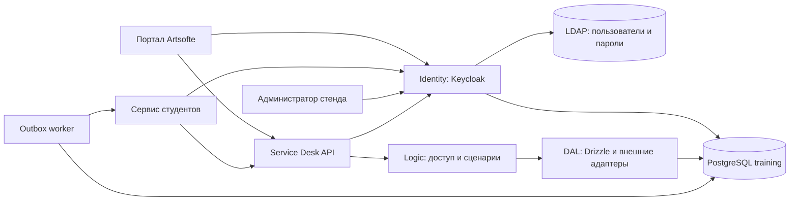

# Архитектура стенда

Стенд предоставляет Identity и Service Desk для внешнего приложения студентов. Студенты администрируют выданный стенд через Keycloak и API настроек; приложение обработки обращений разрабатывают в отдельном репозитории.

## Компоненты и данные

| Компонент      | Код                     | Ответственность                                           |
| -------------- | ----------------------- | --------------------------------------------------------- |
| Identity       | `apps/identity`         | Вход, пользователи, роли, LDAP federation, тема Keycloak  |
| Service Desk   | `apps/service-desk/src` | Обращения, переписка, статусы, исполнители и API настроек |
| Портал         | `apps/service-desk/ui`  | Создание, просмотр, переписка и закрытие обращения        |
| Общий UI       | `libs/ui`, `libs/theme` | PrimeNG/Aura, SCSS-токены и оформление Identity           |
| Инфраструктура | `infra`                 | Compose и подготовка постоянных хранилищ                  |

Один PostgreSQL хранит БД `training`. Service Desk использует схему `public`, Keycloak — `identity` с отдельной SQL-ролью. Пароли пользователей хранятся в LDAP. Compose включает пять сервисов: `postgres`, `ldap`, `identity`, одноразовый `migrate` и `service-desk`. API и портал работают в одном контейнере.

## Вход и доступ

Портал использует публичный клиент `service-desk-test`, Swagger — `service-desk-swagger`, приложение студентов — `student-service`. Браузерные клиенты входят через Authorization Code + PKCE S256. Пароль принимает Keycloak; Service Desk проверяет access JWT через JWKS и не создаёт серверную cookie-сессию.

API использует роли клиента `service-desk`: `customer`, `support`, `support-lead`, `admin`. Руководитель наследует `support`. Атрибут `team_slug` связывает пользователя с активной службой в таблице `teams`; сам атрибут новую службу не создаёт. Доступ ограничивается сервером и условиями DAL.

## Обработка обращения

1. API проверяет токен и поля формы.
2. Logic находит единственного активного руководителя своего Service Desk в Identity. Новое обращение назначается ему.
3. Обращение, история и событие `jira:issue_created` сохраняются одной транзакцией.
4. Worker отправляет событие на настроенный HTTPS-адрес приложения студентов.
5. Сервис студентов распределяет обращения через API. Портал лишь показывает исполнителя.
6. Закрытие меняет статус и снимает исполнителя одной транзакцией с историей и `jira:issue_updated`.

Успех создания не означает доставку webhook. Повторы возможны, порядок событий не гарантируется.

## Источники состояния

- LDAP — пользователи, пароли и `team_slug`, редактируемые через Keycloak.
- Схема `identity` — клиенты, роли и назначения Keycloak.
- Схема `public` — обращения, службы, история, outbox, доставки и совместимые статические токены.
- `SETTINGS_FILE` — рабочий JSON настроек. Адреса уведомлений worker применяет без перезапуска; остальные параметры читаются при запуске.

## Документы по областям

| Задача                        | Документ                                                           |
| ----------------------------- | ------------------------------------------------------------------ |
| Устройство сервера и миграции | [Сервер](backend.md)                                               |
| Проверка доступа и доставка   | [Безопасность и события](security-and-events.md)                   |
| Портал и тема Keycloak        | [Интерфейс](identity-theme.md)                                     |
| Причины архитектурных решений | [Решения](decisions.md)                                            |
| Совместимость Jira API        | [Контракт API](../api-compatibility.md)                            |
| JSON настроек                 | [Настройки](../settings.md)                                        |
| Запуск и постоянные данные    | [Docker](../docker.md), [подготовка окружения](../agents/setup.md) |
| Выбор проверок                | [Матрица](../agents/verification.md)                               |
| Подключение сервиса студентов | [Три инструкции](../student-integration.md)                        |

## Границы реализации

Стенд реализует выбранное подмножество Jira Data Center 10.3. Тип `10001` — локальная форма замены оборудования; типы `183` и `194` описаны отдельно. Вложений, участников, SLA, 1С, массового сброса и автоматического создания службы при добавлении пользователя нет. Внешний HTTPS, публикация и резервное копирование требуют настройки развёртывания.
